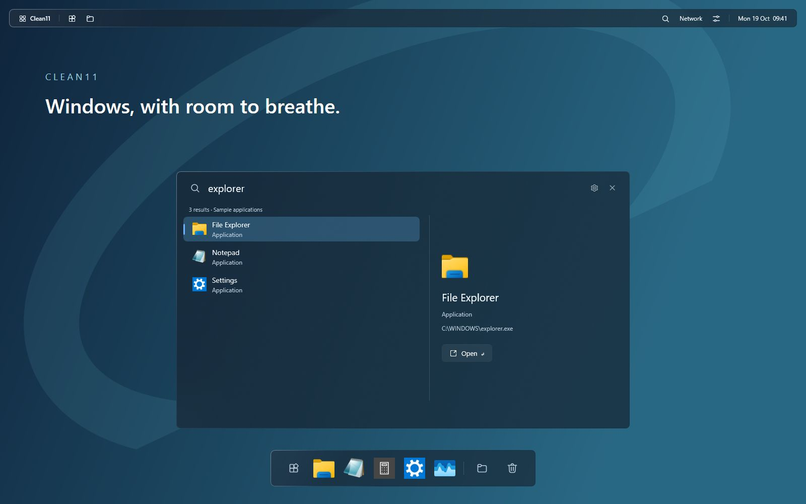
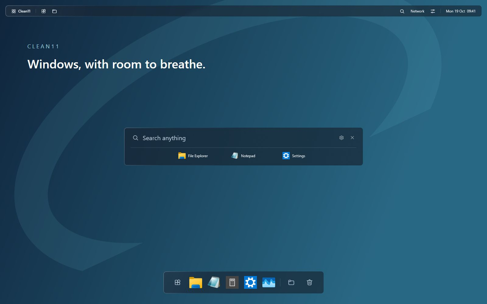
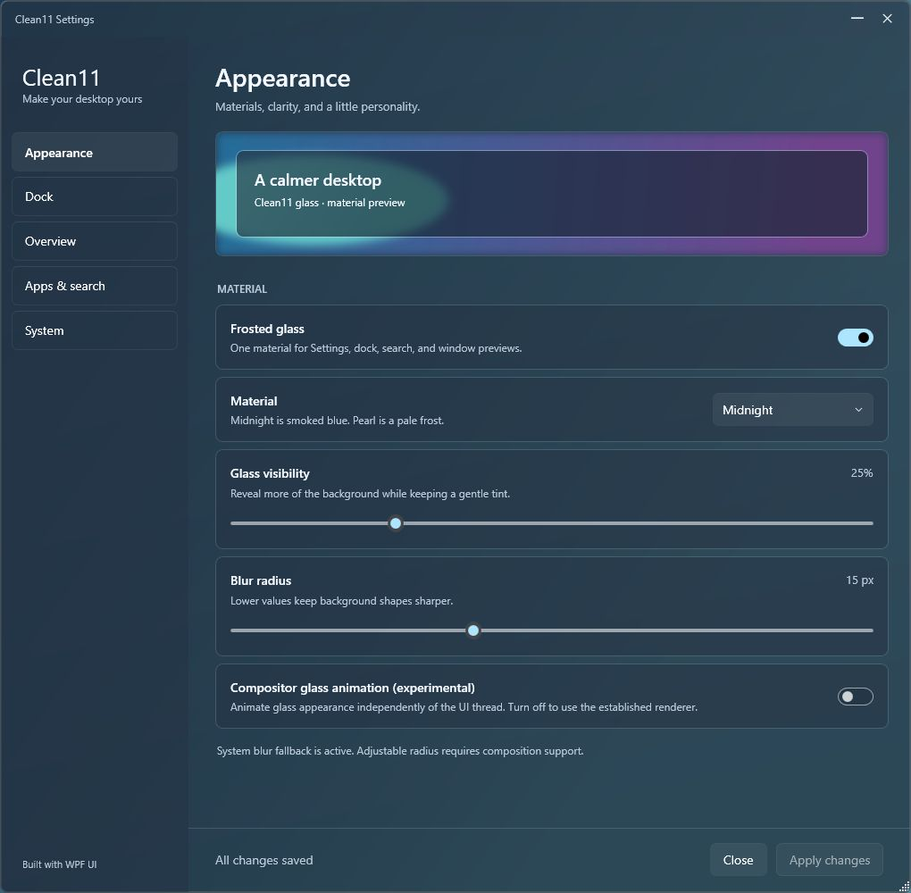

<div align="center">

# Clean11

### Windows, with room to breathe.

A floating dock, a native top bar, a keyboard-first window overview, focused search, and desktop widgets — connected by one glass design system.

**Windows 11 · C# / WPF · WPF UI · Active prototype**

**Proudly vibe-coded with OpenAI Codex. Human vision. AI collaboration. Obsessive iteration.**

## [☕ Buy me a coffee · Support Clean11](https://buymeacoffee.com/matoxd99)

[Why we vibe-code](#proudly-vibe-coded) · [Explore the features](#a-calmer-everyday-desktop) · [Build from source](#build-from-source) · [Get involved](#help-build-clean11) · [Roadmap](#whats-next) · [Documentation](#documentation)

</div>



> **Actual app screenshots, staged for presentation:** the suite images capture the running top bar, search, and dock together in a dedicated capture harness, with sample Windows apps, a neutral presentation backdrop, and a fixed sample clock. Compact search and expanded results are two states of the same component, shown separately below. Personal documents, accounts, conversations, and unrelated windows are excluded.

## Proudly vibe-coded

Clean11 is built through hands-on collaboration with **OpenAI Codex**, and we're proud of it. The idea, taste, and direction come from a human; AI helps turn them into working software through code, debugging, design exploration, and iteration.

Our workflow is simple: describe the experience, build it, try it on a real desktop, point out what feels wrong, and keep refining. A dock that feels off, a flickering label, or an awkward animation becomes the next conversation and the next improvement.

For us, vibe-coding makes ambitious personal software possible. Clean11 is an ongoing experiment in how far human creativity and AI collaboration can take a Windows desktop project. The source is here so you can explore it, question the decisions, report bugs, and follow the progress.

## A calmer everyday desktop

Clean11 brings the useful parts of a desktop closer together: find something, switch windows, open an app, and get back to work. Familiar Windows actions stay at the center of the experience.

### Your windows, at a glance

Open the overview with the Windows key, then choose a window or start typing. Live previews, compact minimized-window cards, and readable labels help you find your place. Pressing the key again during entrance reverses the animation.

### A dock that stays out of your way

Pin your everyday apps alongside running windows. Smooth magnification, grouped window previews, Downloads, and quick actions keep things close without filling the desktop with controls.

Choose **Never hide**, **Auto hide**, or **Intelligent** behavior. Hiding in fullscreen is a separate preference.

### Search without the clutter

Typing in overview expands the top search field into a focused panel for applications, windows, files, folders, and Windows settings. Favorites and keyboard navigation keep common actions close.

File-search coverage depends on the available index/provider. The optional Everything SDK is not bundled.



*Compact search with favorites above; expanded search with results is shown at the top of this page. Both captures use the real Clean11 controls and shared glass material.*

### Everyday controls at the top

The top bar brings window actions, search, clock and calendar, Wi-Fi, Bluetooth, and sound controls into the same glass design. Select input/output devices and adjust app volumes from the integrated mixer. Advanced and device-specific controls remain available through Windows Settings.

### Little spaces for your desktop

Clock, calendar, local to-do, and notes bring useful information onto the desktop. Add cards from the gallery integrated into Clean11 Settings, arrange and resize them, and follow the same glass appearance as the rest of Clean11. Notes, tasks, and layouts stay on your PC. [Widget guide](docs/WIDGETS.md).

*Included in v0.3.0 Alpha.*

### A horizon that follows your day

Clean11 Horizon is one original landscape in eight lighting states, switched using the local PC clock. New installations start with Dynamic Horizon after backing up the previous background; updates keep your existing preference. Choose Dynamic, Always light, or Always dark from the new Wallpaper page. Preview any time without changing the desktop, and restore the previous background when you turn Horizon off. [Wallpaper guide](docs/WALLPAPER.md).

*Included in v0.3.0 Alpha.*

### One place to make it yours

Appearance, Wallpaper, Dock, Top Bar, Widgets, Overview, Apps & search, and System live together in Clean11 Settings. Shared glass visibility and blur radius apply across supported Clean11 surfaces. Choose a material, tune motion, and decide whether **Live game previews** are enabled.



## What works today

| Component | Current scope |
| :-- | :-- |
| **Window overview** | Live window previews, minimized cards, close actions, reversible entrance motion |
| **Search** | Apps, windows, Windows settings, favorites, and provider-dependent file/folder results |
| **Floating dock** | Pins, running apps, magnification, grouped previews, Downloads, and hide modes |
| **Top bar** | Active-app actions, calendar, battery, quick controls, Wi-Fi, Bluetooth, and audio mixer |
| **Desktop widgets** | Clock, month calendar, local tasks and notes; gallery, sizes, saved layouts, shared glass (v0.3.0) |
| **Settings** | Shared appearance, dock behavior, overview controls, and live game preview preference |
| **Wallpaper** | Horizon: eight generated lighting states, offline local-time switching, previews, and previous-background restoration (v0.3.0) |
| **Glass** | Adjustable visibility and blur, with a system fallback where composition is unavailable |
| **Modern runtime** | Separate .NET 10 build candidate; the established app still uses .NET Framework |

**This is a working prototype, not a finished desktop replacement.** A local preview MSI now packages the implemented modules; a clean Sandbox lifecycle test is still pending. The top bar, integrated device panels, desktop widgets, unified Settings and Horizon wallpaper are included in v0.3.0 Alpha. The broader custom Desktop remains planned. Optional tray and power-menu integrations use available compatibility components, with native fallbacks; see [current limitations](docs/DOCK.md).

## Install the preview

The MSI installs overview/search, the dock with its integrated top bar and device panels, unified Settings, desktop widgets, Horizon wallpaper, runtime support DLLs, and dependency notices for the current Windows account. It adds Start-menu entries for **Clean11**, **Clean11 Settings**, and **Exit Clean11**, plus an optional sign-in startup entry. Windows 11 supplies the required .NET Framework runtime.

Download the unsigned preview MSI from [GitHub Releases](https://github.com/MatoXD99/clean11/releases). Clean Sandbox lifecycle testing is still pending. To build an installer from source:

```powershell
.\installer\Build.ps1 -Version 0.3.0
```

The result is `artifacts/installer/Clean11-0.3.0-x64.msi`. Double-click it to install. Open Clean11 from Start; first launch opens Settings so you can choose taskbar integration. Uninstall through Windows **Installed apps**; personal preferences are retained.

See [installer validation and Windows Sandbox](docs/BUILDING.md#installer-and-windows-sandbox) for the test workflow and current release gates. The preview package is unsigned and has not yet passed a clean Sandbox install/repair/upgrade/uninstall run.

## Build from source

### Requirements

- Windows 11, x64.
- PowerShell and the Windows .NET Framework compiler/runtime.
- Internet access to restore the pinned WPF UI packages from NuGet.

```powershell
git clone https://github.com/MatoXD99/clean11.git
cd clean11

# Restore dependencies, then build overview/search.
.\src\Clean11.Overview\RestoreDependencies.ps1
.\src\Clean11.Overview\Build.ps1

# Build the dock and Settings launcher using the same dependencies.
.\src\Clean11.Dock\Build.ps1
```

Build outputs:

- `src/Clean11.Overview/ActivitiesOverview.exe` — overview/search; the executable name is retained for compatibility.
- `src/Clean11.Dock/bin/Clean11.Dock.exe` — floating dock and Settings host.
- `src/Clean11.Dock/bin/Clean11.Settings.exe` — Settings launcher.
- `src/Clean11.Dock/bin/Clean11.Widgets.exe` — desktop widget host; its gallery is integrated into Settings.

Keep companion DLLs beside each executable. Building does **not** install the app. Read [build instructions](docs/BUILDING.md) and [dock installation and recovery](docs/DOCK.md) before enabling startup or changing bottom-bar integration.

The isolated **.NET 10 candidate** can be built with a .NET 10 SDK:

```powershell
.\src\Clean11.Modern\Build.ps1
```

It is not yet the default runtime or an installer-ready release.

## Built for Windows

**C# + WPF UI** provide controls, icons, and theme resources. Native Windows previews and composition supply the custom overview and glass layers. WPF UI is an active dependency, even where Clean11 supplies its own layout and motion.

Performance work focuses on reducing preparation, keeping file I/O out of animation callbacks, reusing resources, and measuring frame timing. An optional compositor glass reveal is available experimentally. See [measurement tools and runtime status](docs/BUILDING.md#performance-implementation) for the scope and limitations.

## Privacy by design

- Core use requires no Clean11 account; personal settings and search state stay in per-user local storage.
- The repository contains source, documentation, license notices, and reviewed app screenshots captured with sample content.
- Private configuration, logs, traces, keys, generated binaries, and build caches are excluded from source control.
- Before sharing a bug report, remove personal window titles, file paths, queries, and account details from screenshots or logs.

See [privacy and release engineering](docs/PRIVACY-AND-RELEASE.md) for the complete policy. The source audit is not a certification of every runtime behavior or future release artifact.

## What's next

- [x] Overview and focused search prototype
- [x] Floating dock and unified Settings
- [x] Shared glass controls and animation improvements
- [ ] Broader performance, accessibility, and multi-monitor validation
- [ ] Promote the modern runtime after compatibility checks
- [x] Clean11 Top Bar with Wi-Fi, Bluetooth, and audio controls
- [x] Initial desktop widgets: clock, calendar, local to-do, and notes (source preview)
- [ ] Broader custom Desktop module
- [x] Preview per-user MSI and unified app launcher
- [ ] Clean Sandbox lifecycle, upgrades, and recovery validation
- [ ] Signed public installer release

Follow the [delivery roadmap](docs/ROADMAP.md) for the larger desktop-suite plan. Planned features are not included in the current prototype unless marked above.

## Documentation

| Guide | What you'll find |
| :-- | :-- |
| [Build & performance](docs/BUILDING.md) | Dependencies, builds, diagnostics, and the modern-runtime candidate |
| [Wallpaper](docs/WALLPAPER.md) | Horizon artwork, local schedule, settings, backups, and limitations |
| [Desktop widgets](docs/WIDGETS.md) | Gallery, layouts, local content, material behavior, and credits |
| [Dock](docs/DOCK.md) | Behavior, settings, installation, recovery, and limitations |
| [Product plan](docs/PRODUCT-PLAN.md) | The complete Clean11 desktop vision |
| [Design system](docs/DESIGN-SYSTEM.md) | Materials, spacing, typography, and motion |
| [Architecture](docs/ARCHITECTURE.md) | Module boundaries and Windows integration |
| [Privacy & releases](docs/PRIVACY-AND-RELEASE.md) | Repository hygiene and distribution requirements |

## Help build Clean11

**Any help is welcome.** Clean11 is an active personal project, and you don't need to be a developer to help shape it. Bug reports, feature ideas, design feedback, documentation improvements, and code contributions all make a difference. First-time contributors are welcome too.

- **Found a bug or have an idea?** [Open an issue](https://github.com/MatoXD99/clean11/issues). For bugs, include what happened, what you expected, steps to reproduce, and your Windows and Clean11 versions. Screenshots help; remove personal information before sharing them.
- **Want to contribute code or docs?** Fork the repository, make your changes on a branch, and [open a pull request](https://github.com/MatoXD99/clean11/pulls). Explain what changed and how you checked it. For larger changes, open an issue first so we can agree on the direction.
- **Trying the alpha?** Tell me what feels smooth, what feels awkward, and what breaks on your setup. Practical feedback is especially useful at this stage.

I'll do my best to respond to issues and review pull requests promptly, work through reported problems, and merge improvements that fit the project. This is a personal project, so turnaround can vary, but feedback is welcome and appreciated.

## Support Clean11

Enjoying Clean11? Help fuel the next coding session. Every tip is appreciated and helps keep the project moving. Reporting a bug or sharing an idea is just as welcome.

<div align="center">

## [☕ Buy me a coffee](https://buymeacoffee.com/matoxd99)

**Support the next round of Clean11 improvements.**

</div>

## Credits & licensing

Clean11 uses **[WPF UI](https://github.com/lepoco/wpfui)** by Leszek Pomianowski and the WPF UI Contributors, licensed under MIT. Its controls and themes are a foundation of the project. The required [license](licenses/WPF-UI-LICENSE.txt) and [third-party notices](THIRD-PARTY-NOTICES.md) are retained.

Desktop widget bottom-order behavior selectively adapts **[DeskWidgets](https://github.com/VaticUI/DeskWidgets)** by VaticUI, under MIT. Its [full license](licenses/DESKWIDGETS-LICENSE.txt) is included in source and installer distributions. The widget UI and local data layer are implemented for Clean11.

Adapted components also credit Flow Launcher / Wox and WindowScatter. See the notices for provenance and license texts.

**A license for Clean11's own code has not yet been selected.** Dependency licenses apply to their respective components and do not automatically license the whole repository. Public source availability alone is not a broad reuse grant.

The README screenshots show the running Clean11 UI with neutral sample content. They were reviewed for personal information and contain no embedded image metadata. No third-party reference screenshots or vendor wallpapers are bundled.
