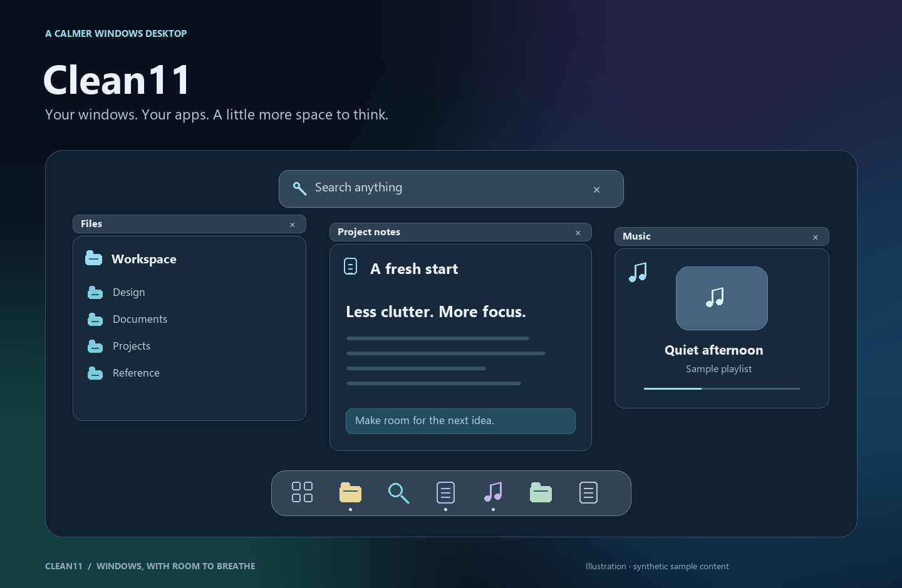
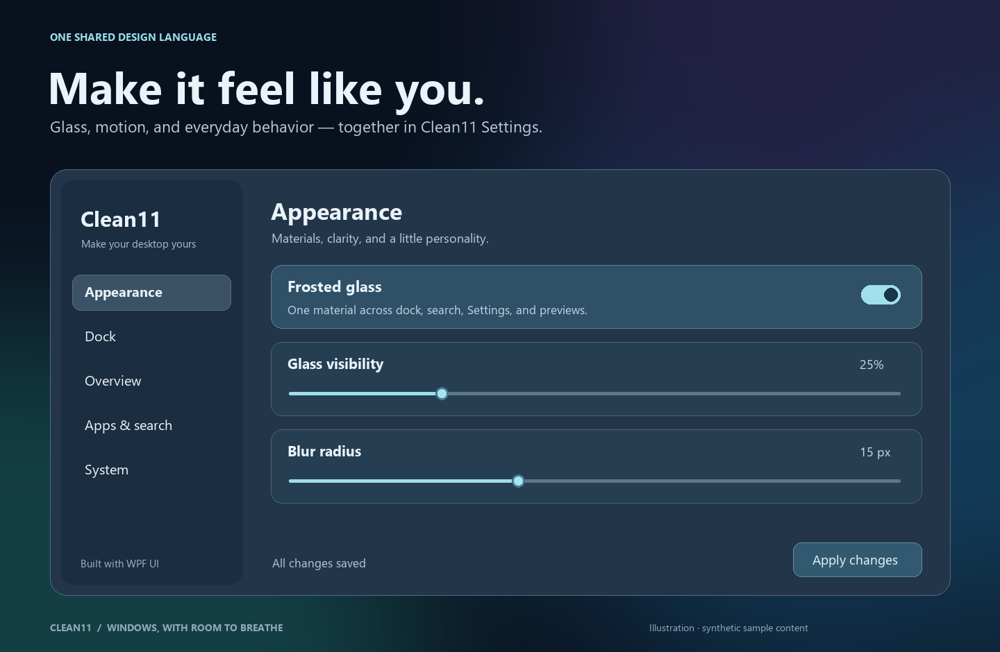

<div align="center">

# Clean11

### Windows, with room to breathe.

A floating dock, a keyboard-first window overview, and a focused search experience — connected by one glass design system.

**Windows 11 · C# / WPF · WPF UI · Active prototype**

**Proudly vibe-coded with OpenAI Codex. Human vision. AI collaboration. Obsessive iteration.**

[Why we vibe-code](#proudly-vibe-coded) · [Explore the features](#a-calmer-everyday-desktop) · [Build from source](#build-from-source) · [Roadmap](#whats-next) · [Documentation](#documentation)

</div>



> **About the images:** these are original, illustrative previews with synthetic content, not screenshots of a real desktop. They communicate the design direction; the running prototype can differ. No personal documents, accounts, conversations, wallpaper captures, or third-party reference screenshots are included.

## Proudly vibe-coded

Clean11 is built through hands-on collaboration with **OpenAI Codex**, and we're proud of it. The idea, taste, and direction come from a human; AI helps turn them into working software through code, debugging, design exploration, and iteration.

Our workflow is simple: describe the experience, build it, try it on a real desktop, point out what feels wrong, and keep refining. A dock that feels off, a flickering label, or an awkward animation becomes the next conversation and the next improvement.

For us, vibe-coding makes ambitious personal software possible. Clean11 is an ongoing experiment in how far human creativity and AI collaboration can take a Windows desktop project. The source is here so you can explore it, question the decisions, report bugs, and follow the progress.

## A calmer everyday desktop

Clean11 brings the useful parts of a desktop closer together: find something, switch windows, open an app, and get back to work. Familiar Windows actions stay at the center of the experience.

### Your windows, at a glance

Open the overview with the Windows key, then choose a window or start typing. Live previews, compact minimized-window cards, and readable labels help you find your place. Pressing the key again during entrance reverses the animation.

### A dock that stays out of your way

Pin your everyday apps alongside running windows. Smooth magnification, grouped window previews, Downloads, and quick actions keep things close without filling the desktop with controls.

Choose **Never hide**, **Auto hide**, or **Intelligent** behavior. Hiding in fullscreen is a separate preference.

### Search without the clutter

Typing in overview expands the top search field into a focused panel for applications, windows, files, folders, and Windows settings. Favorites and keyboard navigation keep common actions close.

File-search coverage depends on the available index/provider. The optional Everything SDK is not bundled.

### One place to make it yours

Appearance, Dock, Overview, Apps & search, and System live together in Clean11 Settings. Shared glass visibility and blur radius apply across supported Clean11 surfaces. Choose a material, tune motion, and decide whether **Live game previews** are enabled.



## What works today

| Component | Current scope |
| :-- | :-- |
| **Window overview** | Live window previews, minimized cards, close actions, reversible entrance motion |
| **Search** | Apps, windows, Windows settings, favorites, and provider-dependent file/folder results |
| **Floating dock** | Pins, running apps, magnification, grouped previews, Downloads, and hide modes |
| **Settings** | Shared appearance, dock behavior, overview controls, and live game preview preference |
| **Glass** | Adjustable visibility and blur, with a system fallback where composition is unavailable |
| **Modern runtime** | Separate .NET 10 build candidate; the established app still uses .NET Framework |

**This is a working prototype, not a finished desktop replacement.** Top Bar, Desktop, and public EXE/MSI installers remain planned. Some tray and power-menu actions still use compatibility integrations; see [current limitations](docs/DOCK.md).

## Build from source

### Requirements

- Windows 11, x64.
- PowerShell and the Windows .NET Framework compiler/runtime.
- Internet access to restore the pinned WPF UI packages from NuGet.

```powershell
git clone https://github.com/MatoXD99/clean11.git
cd clean11

# Restore dependencies, then build overview/search.
.\src\Clean11.Overview\RestoreDependencies.ps1
.\src\Clean11.Overview\Build.ps1

# Build the dock and Settings launcher using the same dependencies.
.\src\Clean11.Dock\Build.ps1
```

Build outputs:

- `src/Clean11.Overview/ActivitiesOverview.exe` — overview/search; the executable name is retained for compatibility.
- `src/Clean11.Dock/bin/Clean11.Dock.exe` — floating dock and Settings host.
- `src/Clean11.Dock/bin/Clean11.Settings.exe` — Settings launcher.

Keep companion DLLs beside each executable. Building does **not** install the app. Read [build instructions](docs/BUILDING.md) and [dock installation and recovery](docs/DOCK.md) before enabling startup or changing bottom-bar integration.

The isolated **.NET 10 candidate** can be built with a .NET 10 SDK:

```powershell
.\src\Clean11.Modern\Build.ps1
```

It is not yet the default runtime or an installer-ready release.

## Built for Windows

**C# + WPF UI** provide controls, icons, and theme resources. Native Windows previews and composition supply the custom overview and glass layers. WPF UI is an active dependency, even where Clean11 supplies its own layout and motion.

Performance work focuses on reducing preparation, keeping file I/O out of animation callbacks, reusing resources, and measuring frame timing. An optional compositor glass reveal is available experimentally. See [measurement tools and runtime status](docs/BUILDING.md#performance-implementation) for the scope and limitations.

## Privacy by design

- Core use requires no Clean11 account; personal settings and search state stay in per-user local storage.
- The repository contains source, documentation, license notices, and original synthetic illustrations.
- Private configuration, logs, traces, keys, generated binaries, and build caches are excluded from source control.
- Before sharing a bug report, remove personal window titles, file paths, queries, and account details from screenshots or logs.

See [privacy and release engineering](docs/PRIVACY-AND-RELEASE.md) for the complete policy. The source audit is not a certification of every runtime behavior or future release artifact.

## What's next

- [x] Overview and focused search prototype
- [x] Floating dock and unified Settings
- [x] Shared glass controls and animation improvements
- [ ] Broader performance, accessibility, and multi-monitor validation
- [ ] Promote the modern runtime after compatibility checks
- [ ] Clean11 Top Bar and Desktop modules
- [ ] EXE/MSI packaging, upgrades, and recovery validation

Follow the [delivery roadmap](docs/ROADMAP.md) for the larger desktop-suite plan. Planned features are not included in the current prototype unless marked above.

## Documentation

| Guide | What you'll find |
| :-- | :-- |
| [Build & performance](docs/BUILDING.md) | Dependencies, builds, diagnostics, and the modern-runtime candidate |
| [Dock](docs/DOCK.md) | Behavior, settings, installation, recovery, and limitations |
| [Product plan](docs/PRODUCT-PLAN.md) | The complete Clean11 desktop vision |
| [Design system](docs/DESIGN-SYSTEM.md) | Materials, spacing, typography, and motion |
| [Architecture](docs/ARCHITECTURE.md) | Module boundaries and Windows integration |
| [Privacy & releases](docs/PRIVACY-AND-RELEASE.md) | Repository hygiene and distribution requirements |

## Credits & licensing

Clean11 uses **[WPF UI](https://github.com/lepoco/wpfui)** by Leszek Pomianowski and the WPF UI Contributors, licensed under MIT. Its controls and themes are a foundation of the project. The required [license](licenses/WPF-UI-LICENSE.txt) and [third-party notices](THIRD-PARTY-NOTICES.md) are retained.

Adapted components also credit Flow Launcher / Wox and WindowScatter. See the notices for provenance and license texts.

**A license for Clean11's own code has not yet been selected.** Dependency licenses apply to their respective components and do not automatically license the whole repository. Public source availability alone is not a broad reuse grant.

The README illustrations are original Clean11 documentation artwork, drawn from synthetic examples with [the included generator](tools/Render-Readme.py). They contain no copied vendor wallpapers, logos, or reference screenshots.
