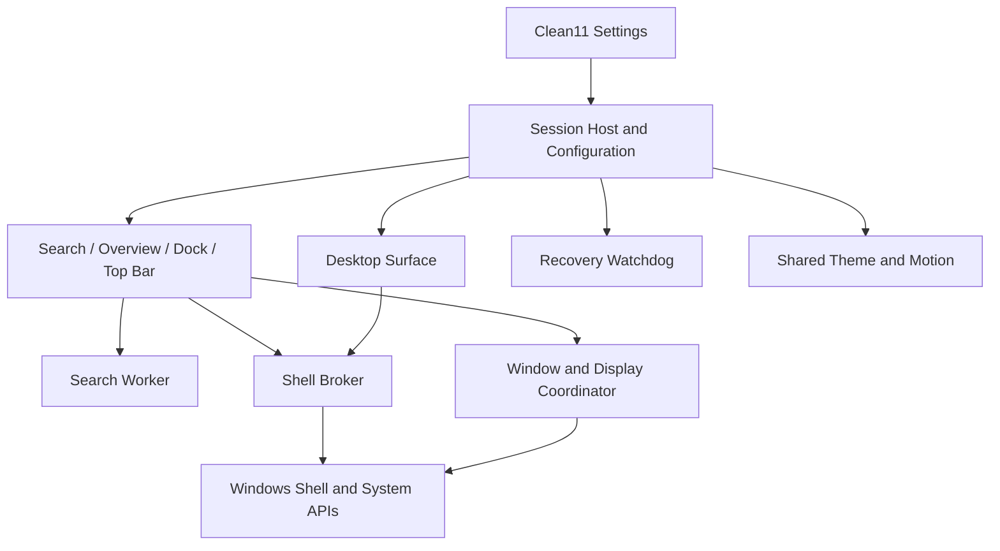

# Architecture and decisions

## Starting point

The existing prototype combines .NET Framework, WinForms, WPF, native preview windows, search providers, and local desktop-suite customizations. Reusable concepts include app discovery, ranking, window enumeration/layout, keyboard handling, and settings discovery.

Known architectural debts include separate window/material layers, wallpaper-preview frosting, split input ownership, environment-specific integration, and fragile settings metadata assumptions. Reuse reviewed logic behind interfaces; do not publish or transplant the entire prototype directory.

## Proposed stack

- C# on .NET 10 LTS, with stable Windows App SDK / WinUI 3 for Settings and ordinary UI. Pin supported SDK/runtime versions during implementation and service them thereafter. [.NET support policy](https://dotnet.microsoft.com/en-us/platform/support/policy/dotnet-core), [Windows App SDK release channels](https://learn.microsoft.com/en-us/windows/apps/windows-app-sdk/release-channels).
- Native Win32 and composition interop for desktop positioning, previews, work areas, activation, and low-level integration. Use a small native helper only where managed interop is insufficient.
- An early renderer prototype decides the final host for shaped shell surfaces. Do not assume WinUI's normal application-window model alone satisfies arbitrary corner, transparency, and input requirements.
- Local structured configuration, a versioned local index/cache, cancellation-aware background providers, and typed IPC contracts.
- No browser runtime is required for core desktop surfaces. No always-elevated UI or privileged service by default.

## Logical components and process boundaries



Logical components do not require one process each. Begin with one session host, one UI host, a separate desktop process, an on-demand search worker, Settings, an isolated shell broker, and a minimal independent recovery watchdog. Consolidate only after measurements. The separation keeps slow providers, extensions, and desktop failures from freezing all input.

The session host owns module lifecycle and shared configuration; the UI host owns the popup/focus state machine. A single window/display coordinator publishes event-driven state to all modules. Named-pipe IPC is versioned, restricted to the current user/session, and validates message sizes and requests. Do not expose an unrestricted command-execution endpoint.

## Windows integration decisions

| Area | Approach | Limitation / fallback |
| --- | --- | --- |
| Shell lifecycle | Run alongside Explorer; record every altered shell setting | Restore native desktop/taskbar on exit, crash recovery, or uninstall |
| Bar work areas | Coordinate through appbar/work-area APIs | Resolve existing appbars; restore registrations on failure |
| Window state | Event-driven enumeration and foreground/display notifications | Exclude own/helper/cloaked windows; handle process exit races |
| Previews | Native DWM previews and optional capture-based renderer | Rounded clipping must be proven; icon/static fallback for unavailable content |
| Fullscreen | Shared per-monitor policy using window bounds, style, state, and optional app rules | Borderless games, presentations, exclusive modes, and remote sessions need separate cases |
| Desktop | Desktop-level host over existing real folders | Hosting/z-order interoperability is a phase-zero gate; native desktop fallback |
| File commands | Shell item identities and IFileOperation on an STA broker | Preserve conflict dialogs, access failures, cancellation, and supported undo |
| Shell extensions | Isolated broker or explicit native menu | Arbitrary extension menus cannot safely be restyled universally |
| Third-party tray | Isolated, version-detected compatibility adapter | Public notify-icon API does not provide a general foreign-icon enumeration contract |
| Notifications | Capability/permission-gated integration | Packaging eligibility must be proven; native center fallback |
| Virtual desktops | Public supported functionality where available | Undocumented adapters are optional and disabled when incompatible |

The tray conclusion is an engineering inference from the documented API surface: `Shell_NotifyIcon` manages notification icons and callbacks; it does not describe a general enumeration API for another application's icons. Do not make full tray replacement a supported-API claim. [Notify-icon reference](https://learn.microsoft.com/en-us/windows/win32/api/shellapi/nf-shellapi-shell_notifyiconw).

Appbar registration and work-area behavior must cooperate with Windows and other desktop tools. [Application desktop toolbars](https://learn.microsoft.com/en-us/windows/win32/shell/application-desktop-toolbars).

Use Windows known folders rather than assuming desktop paths. File operations belong on a single-threaded apartment broker and should retain native error/progress semantics. [Known folders](https://learn.microsoft.com/en-us/windows/win32/api/shlobj_core/nf-shlobj_core-shgetknownfolderpath), [IFileOperation](https://learn.microsoft.com/en-us/windows/win32/api/shobjidl_core/nn-shobjidl_core-ifileoperation).

Notification access requires manifest capability and user permission; an unpackaged executable cannot simply assume availability. Prototype the selected installer/package identity strategy before promising a custom notification center. [Notification listener](https://learn.microsoft.com/en-us/windows/apps/develop/notifications/app-notifications/notification-listener).

## Focus and activation

One state machine: Closed -> Overview -> Search -> modal/settings interactions -> previous state or Closed. Model direct Search as a separate entry reason. Preserve the origin window for restoration when dismissed.

The bare Super hook must distinguish a tap from system-key combinations, auto-repeat, injected events, and modifier transitions. Win+L, Win+D, Win+E and other combinations remain functional. Keep hook callbacks short; never search or render within a keyboard hook.

No-activate previews, badges, and tooltips cannot take keyboard focus. Shell-owned dialogs and native context menus are tracked as part of the current interaction so they do not trigger premature dismissal. Tray and user-menu toggles use the same serialized state rules.

## Launch policy

Centralize launches from Search, Dock, Desktop, history, and context menus. Respect shortcut working directories and shell activation contracts. Explicit terminal-here commands use the selected folder; generic terminal launches use the user home directory when no target specifies a working directory. Never inherit a development/build directory accidentally. Use structured arguments and shell APIs, not concatenated command strings.

## Search contracts

Each provider declares capabilities, scope, cost, refresh policy, privacy requirements, and a cancellation-aware query interface. Results include stable identity, label, category, score inputs, activation target, and supported actions. The ranking layer owns cross-provider ordering and deduplication.

Separate app discovery from query execution. Query execution reads a snapshot; updates swap snapshots atomically. Provider errors degrade that provider only. Network and clipboard providers are disabled until enabled by the user.

Settings catalogs use OS/language/source signatures, schema adapters, bounded parsing, validated routes, and last-good-cache behavior. Provider refreshes never block typing.

## Recovery

Before hiding native shell elements, record only the changes Clean11 is responsible for. An independent watchdog restores those elements if the owning processes fail. Restoration should not overwrite unrelated changes made later by the user or another tool.

Provide a documented recovery shortcut, a small recovery executable/command, and a Settings action. Crash loops start in safe mode with desktop replacement and shell hiding disabled. Explorer restarts trigger re-registration and state reconciliation. Exit and uninstall must leave a usable native desktop without rebooting.

## Future source layout

```text
src/
  Clean11.Host/
  Clean11.UI/
  Clean11.Desktop/
  Clean11.Settings/
  Clean11.Search/
  Clean11.ShellBroker/
  Clean11.Recovery/
  Clean11.Platform.Windows/
  Clean11.Design/
tests/
  Unit/
  Integration/
  Visual/
  Compatibility/
packaging/
docs/
```

This layout is a proposal; source projects are not created during the planning session.
